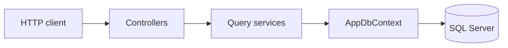

# 5 EF Core Mistakes That Slow Down Your API ⚡

This API demonstrates five common Entity Framework Core performance mistakes with a deliberately inefficient endpoint and a composed alternative. Both sides of each pair return the same logical JSON. The difference is the SQL, the number of round trips, or the work the change tracker does.

The stack is .NET 10, C# 14, EF Core 10, and SQL Server. Sample customers, orders, and products are fictional. The inefficient endpoints exist so the cost is visible. They are not patterns to copy.

Snippets in this guide are the real query shapes from [`QueryShapes.cs`](src/EFCore.Performance.Api/Services/QueryShapes.cs) and the query services. Controllers only validate paging and call those methods. The linked files are the complete implementation.

## Start here

| | |
| --- | --- |
| [Quick start](#quick-start) | Clone, connection string, migrate, run |
| [Five mistakes](#the-five-mistakes) | Same before/after story for each mistake |
| [Call the API](#call-the-ten-endpoints) | Routes, PowerShell, and small JSON samples |
| [Generated SQL](#generated-sql) | Columns, filters, `ToQueryString()`, plans |
| [Benchmarks](#one-local-benchmark-run) | Allocations from one run, and why the timings are weak |
| [Decision guide](#decision-guide) | When to track, include, project, and index |
| [Checklist](#investigation-checklist) | What to inspect on a slow request |

## The five mistakes

| Mistake | Before | After | Main lesson |
| --- | --- | --- | --- |
| [Unnecessary change tracking](#1-unnecessary-change-tracking) | [Tracked read-only entities](src/EFCore.Performance.Api/Services/QueryShapes.cs#L10-L15) | [`AsNoTracking()`](src/EFCore.Performance.Api/Services/QueryShapes.cs#L17-L23) | Avoid unnecessary tracking |
| [N+1 queries](#2-n1-queries) | [Additional queries inside loops](src/EFCore.Performance.Api/Services/NPlusOneQueryService.cs#L23-L46) | [Projection](src/EFCore.Performance.Api/Services/QueryShapes.cs#L32-L43) | Reduce database round trips |
| [Premature materialization](#3-premature-materialization) | [Materialize before filtering](src/EFCore.Performance.Api/Services/MaterializationQueryService.cs#L23-L38) | [Filter before `ToListAsync()`](src/EFCore.Performance.Api/Services/QueryShapes.cs#L52-L70) | Execute filtering in SQL |
| [Fetching unnecessary columns](#4-fetching-unnecessary-columns) | [Load complete entities](src/EFCore.Performance.Api/Services/QueryShapes.cs#L72-L78) | [`Select()` into DTOs](src/EFCore.Performance.Api/Services/QueryShapes.cs#L80-L91) | Retrieve only required columns |
| [Ignoring generated SQL](#5-ignoring-generated-sql) | [Filter in memory, full rows](src/EFCore.Performance.Api/Services/QueryShapes.cs#L93-L97) | [Inspect SQL, plans, and indexes](src/EFCore.Performance.Api/Services/SqlInspectionQueryService.cs) | Measure actual database behavior |

## Where the code lives

| Piece | File |
| --- | --- |
| Tracking endpoints | [`TrackingController.cs`](src/EFCore.Performance.Api/Controllers/TrackingController.cs) |
| N+1 endpoints | [`NPlusOneController.cs`](src/EFCore.Performance.Api/Controllers/NPlusOneController.cs) |
| Materialization endpoints | [`MaterializationController.cs`](src/EFCore.Performance.Api/Controllers/MaterializationController.cs) |
| Projection endpoints | [`ProjectionController.cs`](src/EFCore.Performance.Api/Controllers/ProjectionController.cs) |
| SQL inspection endpoints | [`SqlInspectionController.cs`](src/EFCore.Performance.Api/Controllers/SqlInspectionController.cs) |
| Query shapes shared by the API and diagnostics | [`QueryShapes.cs`](src/EFCore.Performance.Api/Services/QueryShapes.cs) |
| Model, relationships, and the filter index | [`AppDbContext.cs`](src/EFCore.Performance.Api/Data/AppDbContext.cs#L47-L50) |
| Idempotent demo seed | [`DatabaseSeeder.cs`](src/EFCore.Performance.Api/Data/DatabaseSeeder.cs) |
| Seed size | [`DemoSeed.cs`](src/EFCore.Performance.Api/Data/DemoSeed.cs) |
| Index created by the migration | [`20261028115635_InitialCreate.cs`](src/EFCore.Performance.Api/Data/Migrations/20261028115635_InitialCreate.cs#L127-L130) |
| Entities | [`Customer`](src/EFCore.Performance.Api/Entities/Customer.cs), [`Order`](src/EFCore.Performance.Api/Entities/Order.cs), [`OrderItem`](src/EFCore.Performance.Api/Entities/OrderItem.cs), [`Product`](src/EFCore.Performance.Api/Entities/Product.cs) |
| Response DTOs | [`OrderReadResponse`](src/EFCore.Performance.Api/DTOs/OrderReadResponse.cs), [`NPlusOneOrderResponse`](src/EFCore.Performance.Api/DTOs/NPlusOneOrderResponse.cs), [`FilteredOrderResponse`](src/EFCore.Performance.Api/DTOs/FilteredOrderResponse.cs), [`ProjectedOrderResponse`](src/EFCore.Performance.Api/DTOs/ProjectedOrderResponse.cs), [`SqlInspectionOrderResponse`](src/EFCore.Performance.Api/DTOs/SqlInspectionOrderResponse.cs) |
| SQL Server tests | [`SqlServerIntegrationTests.cs`](tests/EFCore.Performance.Tests/Integration/SqlServerIntegrationTests.cs) |
| SQLite behavioral tests | [`SqliteEndpointTests.cs`](tests/EFCore.Performance.Tests/Integration/SqliteEndpointTests.cs) |
| Production diagnostics stay hidden | [`DiagnosticsExposureTests.cs`](tests/EFCore.Performance.Tests/Integration/DiagnosticsExposureTests.cs) |
| Seeder idempotency | [`DatabaseSeederTests.cs`](tests/EFCore.Performance.Tests/Unit/DatabaseSeederTests.cs) |
| Index metadata | [`OrderIndexConfigurationTests.cs`](tests/EFCore.Performance.Tests/Unit/OrderIndexConfigurationTests.cs) |
| Ready-made HTTP calls | [`EFCore.Performance.Api.http`](src/EFCore.Performance.Api/EFCore.Performance.Api.http) |



A customer has many orders. An order has many order items. An order item references a product. Money is `decimal(18,2)`. Instants are `DateTimeOffset`. Keys are `int` identities.

## Quick start

From a new clone:

```powershell
git clone https://github.com/<your-account>/EFCore-Performance-Mistakes.git
cd EFCore-Performance-Mistakes
dotnet restore EFCore-Performance-Mistakes.slnx
dotnet tool restore
dotnet tool run dotnet-ef database update --project src/EFCore.Performance.Api --startup-project src/EFCore.Performance.Api
dotnet run --project src/EFCore.Performance.Api
```

The launch profile listens on `http://localhost:5093` and sets `ASPNETCORE_ENVIRONMENT=Development`. Development seeds the demo data when the tables are empty and enables SQL command logging plus `GET /api/sql-inspection/diagnostics`.

`global.json` asks for SDK `10.0.401` and rolls forward inside the 10.0 feature band. Install the .NET 10 SDK if that band is missing. Do not retarget the projects to an older SDK to force a restore.

### Connection string

The checked-in value uses Windows authentication and contains no password:

```text
Server=localhost;Database=EFCorePerformanceDemo;Trusted_Connection=True;TrustServerCertificate=True
```

Change it for your instance. Do not commit a password.

Environment variable for the current PowerShell process:

```powershell
$env:ConnectionStrings__DefaultConnection = "Server=localhost;Database=EFCorePerformanceDemo;User Id=efdemo;Password=<your-password>;TrustServerCertificate=True"
```

User secrets stay outside the repository:

```powershell
dotnet user-secrets set "ConnectionStrings:DefaultConnection" "Server=localhost;Database=EFCorePerformanceDemo;User Id=efdemo;Password=<your-password>;TrustServerCertificate=True" --project src/EFCore.Performance.Api
```

`TrustServerCertificate=True` is a local convenience, not a production setting. Environment variables and user secrets override `appsettings.json`.

Apply schema changes with the EF tool shown above. Startup does not migrate unless `Database:ApplyMigrationsOnStartup` is set to `true`.

Three database names are intentional:

| Database | Purpose |
| --- | --- |
| `EFCorePerformanceDemo` | The API |
| `EFCorePerformanceTests` | SQL Server integration tests. The name must contain `Test`. |
| `EFCorePerformanceBenchmarks` | Benchmark data only. The runner refuses to delete any other catalog. |

### Sample data

| Table | Rows |
| --- | --- |
| Products | 12 |
| Customers | 20 |
| Orders | 100, five per customer |
| Order items | 300, three per order |

`ORD-0001` is customer `Customer 01`, status `Pending`, placed at `2024-01-02T00:00:00Z`, total `170.00`, with three items. Orders then cycle through Pending, Paid, Shipped, and Cancelled. Notes, descriptions, and addresses are long fictional text so a full-row read is wider than a projection.

`DatabaseSeeder` inserts only when all four tables are empty. If those exact counts are already present, it does nothing. A second API start does not duplicate rows. `scripts/seed-database.sql` follows the same contract and also returns without inserting when any demo table already has rows:

```powershell
sqlcmd -S localhost -E -C -d EFCorePerformanceDemo -i scripts/seed-database.sql
```

This set can show extra round trips, a filter that drops rows, and unused columns. It is not a production workload. The inefficient materialization paths also stop at 500 rows. With 100 seeded orders that cap does not change the JSON. Past 500 rows those endpoints can disagree with the composed queries.

### Tests

```powershell
dotnet test EFCore-Performance-Mistakes.slnx -c Release --filter FullyQualifiedName~EFCore.Performance.Tests.Unit
dotnet test EFCore-Performance-Mistakes.slnx -c Release --filter Category=SqlServer
```

Unit tests do not need SQL Server. One of them uses SQLite only to prove the seeder can run twice. That is not a SQL Server result.

SQL Server tests migrate and seed `EFCorePerformanceTests`. If the server is unreachable, each of those tests is skipped with the text `This skipped test is not a passing SQL Server verification.` A skip is not a pass.

SQLite endpoint tests check paging, projection equality, and the N+1 round-trip pattern. SQLite does not translate this model's `DateTimeOffset` comparisons, so the filtered SQL Server queries are verified only in [`SqlServerIntegrationTests.cs`](tests/EFCore.Performance.Tests/Integration/SqlServerIntegrationTests.cs). EF Core InMemory is not used.

Optional test connection:

```powershell
$env:EFCORE_SQL_SERVER = "localhost"
$env:EFCORE_TEST_CONNECTION = "Server=localhost;Database=EFCorePerformanceTests;Trusted_Connection=True;TrustServerCertificate=True"
```

## Call the ten endpoints

List routes accept `skip` (default 0, maximum 1000) and `take` (default 20, maximum 50). Filtered routes also accept `status` (`Pending`, `Paid`, `Shipped`, or `Cancelled`; default `Shipped`) and `placedAfter` (default `2024-02-01T00:00:00Z`).

Use the same query string on `before` and `after`. Invalid paging or status returns 400. `GET /api/tracking/orders/999999` returns 404. Unhandled errors return a generic 500 problem document with no exception text and no stack trace.

Replace `before` with `after` in each command. The host below assumes the launch profile.

### 1. Tracking

`GET /api/tracking/before?take=1` and `GET /api/tracking/after?take=1`

```powershell
curl.exe -s "http://localhost:5093/api/tracking/before?take=1"
curl.exe -s "http://localhost:5093/api/tracking/after?take=1"
```

Both return `ORD-0001`:

```json
[
  {
    "id": 1,
    "orderNumber": "ORD-0001",
    "customerId": 1,
    "customerName": "Customer 01",
    "status": "Pending",
    "placedAt": "2024-01-02T00:00:00+00:00",
    "totalAmount": 170.00
  }
]
```

The JSON matches. In the Development log, both commands still read the order and customer rows. Tracking is C# work after the read, so the SQL text looks alike. Watch allocations in the benchmark, not a different `SELECT` list. Email, notes, and the shipping address are loaded and then left out of this DTO.

One order by id: `GET /api/tracking/orders/1`.

### 2. N+1

`GET /api/nplusone/before?take=2` and `GET /api/nplusone/after?take=2`

```powershell
curl.exe -s "http://localhost:5093/api/nplusone/before?take=2"
curl.exe -s "http://localhost:5093/api/nplusone/after?take=2"
```

```json
[
  {
    "id": 1,
    "orderNumber": "ORD-0001",
    "customerName": "Customer 01",
    "itemCount": 3,
    "totalAmount": 170.00
  },
  {
    "id": 2,
    "orderNumber": "ORD-0002",
    "customerName": "Customer 01",
    "itemCount": 3,
    "totalAmount": 147.00
  }
]
```

Watch the log while `before` runs. Two orders produce five commands. The shape is explained in [N+1 queries](#2-n1-queries). `after` returns the same two objects from one command.

### 3. Materialization

`GET /api/materialization/before?take=2&status=Shipped&placedAfter=2024-02-01T00:00:00Z`

`GET /api/materialization/after?take=2&status=Shipped&placedAfter=2024-02-01T00:00:00Z`

```powershell
curl.exe -s "http://localhost:5093/api/materialization/before?take=2&status=Shipped&placedAfter=2024-02-01T00:00:00Z"
curl.exe -s "http://localhost:5093/api/materialization/after?take=2&status=Shipped&placedAfter=2024-02-01T00:00:00Z"
```

```json
[
  {
    "id": 31,
    "orderNumber": "ORD-0031",
    "customerName": "Customer 07",
    "status": "Shipped",
    "placedAt": "2024-02-01T00:00:00+00:00",
    "totalAmount": 242.00
  },
  {
    "id": 35,
    "orderNumber": "ORD-0035",
    "customerName": "Customer 07",
    "status": "Shipped",
    "placedAt": "2024-02-05T00:00:00+00:00",
    "totalAmount": 110.00
  }
]
```

The response is two shipped orders. The `before` SQL has no `WHERE`. The `after` SQL filters `Status` and `PlacedAt` and pages in SQL Server.

### 4. Projection

`GET /api/projection/before?take=1` and `GET /api/projection/after?take=1`

```powershell
curl.exe -s "http://localhost:5093/api/projection/before?take=1"
curl.exe -s "http://localhost:5093/api/projection/after?take=1"
```

```json
[
  {
    "id": 1,
    "orderNumber": "ORD-0001",
    "customerName": "Customer 01",
    "placedAt": "2024-01-02T00:00:00+00:00",
    "totalAmount": 170.00
  }
]
```

Same JSON as each other. `before` still selects `InternalNotes`, `ShippingAddress`, `Email`, and customer `Notes`. `after` selects the five response fields. Confirm that on the diagnostics endpoint, not by diffing this JSON.

### 5. SQL inspection

`GET /api/sql-inspection/before?take=2&status=Shipped&placedAfter=2024-02-01T00:00:00Z`

`GET /api/sql-inspection/after?take=2&status=Shipped&placedAfter=2024-02-01T00:00:00Z`

```powershell
curl.exe -s "http://localhost:5093/api/sql-inspection/before?take=2&status=Shipped&placedAfter=2024-02-01T00:00:00Z"
curl.exe -s "http://localhost:5093/api/sql-inspection/after?take=2&status=Shipped&placedAfter=2024-02-01T00:00:00Z"
```

```json
[
  {
    "id": 31,
    "orderNumber": "ORD-0031",
    "status": "Shipped",
    "placedAt": "2024-02-01T00:00:00+00:00",
    "totalAmount": 242.00
  },
  {
    "id": 35,
    "orderNumber": "ORD-0035",
    "status": "Shipped",
    "placedAt": "2024-02-05T00:00:00+00:00",
    "totalAmount": 110.00
  }
]
```

Same rows as the materialization pair, without the customer name. Then, in Development only:

```powershell
curl.exe -s "http://localhost:5093/api/sql-inspection/diagnostics?take=5&status=Shipped&placedAfter=2024-02-01T00:00:00Z"
```

That payload is `ToQueryString()` for the projection, materialization, SQL-inspection, and N+1 shapes, plus a note about `IX_Orders_Status_PlacedAt_Id`. It does not accept SQL from the caller. Outside Development the route returns 404 and no SQL. The test is [`SqlDiagnostics_AreNotExposed_WhenTheHostIsProduction`](tests/EFCore.Performance.Tests/Integration/DiagnosticsExposureTests.cs).

## 1. Unnecessary change tracking

**The mistake.** A read-only request materializes `Order` and `Customer` entities with the default tracker.

**Why developers make it.** The query is the normal `DbSet` query. Nothing in the call says "this will be saved," and the tracker is on unless you turn it off.

**BEFORE code.** From [`TrackedOrders`](src/EFCore.Performance.Api/Services/QueryShapes.cs#L10-L15):

```csharp
db.Orders
    .Include(order => order.Customer)
    .OrderBy(order => order.Id)
    .Skip(skip)
    .Take(take)
```

[`GetTrackedAsync`](src/EFCore.Performance.Api/Services/TrackingQueryService.cs) materializes that query and maps it to `OrderReadResponse`. The context never calls `SaveChanges`.

**What makes it inefficient.** SQL Server still runs the query. After the rows arrive, EF Core snapshots each entity, registers it in the identity map, and keeps that graph until the context is disposed. That is extra CPU and memory on a response that only needed a DTO.

**AFTER code.** From [`UntrackedOrders`](src/EFCore.Performance.Api/Services/QueryShapes.cs#L17-L23):

```csharp
db.Orders
    .AsNoTracking()
    .Include(order => order.Customer)
    .OrderBy(order => order.Id)
    .Skip(skip)
    .Take(take)
```

**Why this is preferable here.** The endpoint only reads. Skipping snapshots removes tracker work while the filter, sort, page, and included customer stay the same. These two endpoints still load full rows on purpose. Column selection is [mistake 4](#4-fetching-unnecessary-columns).

**What SQL Server executes.** Both shapes read order columns and customer columns, ordered by `Id`, with `OFFSET`/`FETCH`. Tracking does not remove columns. Parameter values are not logged unless sensitive data logging is turned on. This project leaves that off.

**How to run it.**

```powershell
curl.exe -s "http://localhost:5093/api/tracking/before?take=1"
curl.exe -s "http://localhost:5093/api/tracking/after?take=1"
```

**Tradeoffs.** Use normal tracking when the same context will `SaveChanges` those instances, or when you need one instance per key while the context is alive. `AsNoTrackingWithIdentityResolution()` does not snapshot, but it does deduplicate repeated instances. That matters when one customer appears on many orders in a single `Include`. It is a third mode, not a synonym of `AsNoTracking()`, and it is not free. `AsNoTracking()` does not speed up a query that never materializes entities, such as a DTO projection.

**Implementation and tests.** [`TrackingController.cs`](src/EFCore.Performance.Api/Controllers/TrackingController.cs), [`TrackingQueryService.cs`](src/EFCore.Performance.Api/Services/TrackingQueryService.cs), [`Tracking_BeforeAndAfter_ReturnTheSamePage`](tests/EFCore.Performance.Tests/Integration/SqlServerIntegrationTests.cs#L16). The benchmark is [`TrackingBenchmarks.cs`](src/EFCore.Performance.Benchmarks/TrackingBenchmarks.cs).

## 2. N+1 queries

**The mistake.** The API loads a page of orders, then asks SQL Server for related data once per order.

**Why developers make it.** The first query is obvious. The loop that "just needs the customer name" looks like ordinary C#. Lazy loading is not required to create the pattern, and this project does not enable lazy-loading proxies.

**BEFORE code.** The loop in [`GetBeforeAsync`](src/EFCore.Performance.Api/Services/NPlusOneQueryService.cs) is the mistake:

```csharp
var orders = await QueryShapes.NPlusOneOrderPage(db, skip, take).ToListAsync(cancellationToken);

foreach (var order in orders)
{
    var customerName = await db.Customers
        .AsNoTracking()
        .Where(customer => customer.Id == order.CustomerId)
        .Select(customer => customer.Name)
        .FirstAsync(cancellationToken);

    var itemCount = await db.OrderItems
        .AsNoTracking()
        .CountAsync(item => item.OrderId == order.Id, cancellationToken);
}
```

**What makes it inefficient.** Each `await` is another database round trip. For this method the count is `1 + (2 * N)`: the page, then a customer query and an item-count query for every order. Two orders therefore issue five commands. Eight orders issue seventeen. That formula belongs to this loop. Another N+1, such as a single related query or a lazy-loaded collection, produces a different count.

**AFTER code.** [`NPlusOneProjected`](src/EFCore.Performance.Api/Services/QueryShapes.cs#L32-L43):

```csharp
db.Orders
    .AsNoTracking()
    .OrderBy(order => order.Id)
    .Skip(skip)
    .Take(take)
    .Select(order => new NPlusOneOrderResponse(
        order.Id,
        order.OrderNumber,
        order.Customer.Name,
        order.Items.Count,
        order.TotalAmount))
```

**Why this is preferable here.** The response needs an id, an order number, a customer name, an item count, and a total. It does not need order-item entities. One translated query returns that shape. `order.Items.Count` becomes a scalar subquery, so item rows are not joined into the page.

**What SQL Server executes.** For `take=2`, the Development log showed this sequence on `before`:

1. The page: `SELECT` the order columns `FROM [Orders]` with `ORDER BY [Id]` and `OFFSET`/`FETCH`.
2. `SELECT TOP(1) [c].[Name] FROM [Customers] WHERE [c].[Id] = @order_CustomerId` for `ORD-0001`.
3. `SELECT COUNT(*) FROM [OrderItems] WHERE [OrderId] = @order_Id` for that order.
4. The same customer query for `ORD-0002`.
5. The same count query for `ORD-0002`.

The optimized command observed for that same page was one statement. The representative shape from `ToQueryString()` is:

```sql
SELECT [o0].[Id], [o0].[OrderNumber], [c].[Name], (
    SELECT COUNT(*)
    FROM [OrderItems] AS [o1]
    WHERE [o0].[Id] = [o1].[OrderId]), [o0].[TotalAmount]
FROM (
    SELECT [o].[Id], [o].[CustomerId], [o].[OrderNumber], [o].[TotalAmount]
    FROM [Orders] AS [o]
    ORDER BY [o].[Id]
    OFFSET @p ROWS FETCH NEXT @p1 ROWS ONLY
) AS [o0]
INNER JOIN [Customers] AS [c] ON [o0].[CustomerId] = [c].[Id]
ORDER BY [o0].[Id]
```

EF Core can format this differently across versions. Compare the shape: one command, a customer join, and `COUNT(*)`, not a guarantee of identical whitespace.

`Include` is not automatically the repair. Including one collection is reasonable when the caller will use those entities. Including two collections multiplies rows. A split query trades that explosion for more round trips. A count does not need the item rows at all.

**How to run it.**

```powershell
curl.exe -s "http://localhost:5093/api/nplusone/before?take=2"
curl.exe -s "http://localhost:5093/api/nplusone/after?take=2"
```

Turn command logging on, as Development already does, and count `Executed DbCommand` lines for each request.

**Tradeoffs.** The single query is the right shape for this DTO. If the handler must mutate the loaded orders, load tracked entities deliberately instead of projecting. Command counts depend on this code and on the page size. Five commands is `1 + (2 * 2)` for two orders on this endpoint. It is not what every N+1 problem does.

**Implementation and tests.** [`NPlusOneController.cs`](src/EFCore.Performance.Api/Controllers/NPlusOneController.cs) and [`NPlusOneQueryService.cs`](src/EFCore.Performance.Api/Services/NPlusOneQueryService.cs). The SQL Server test [`NPlusOne_ReturnsTheSameRows_AndExecutesFewerSqlCommands`](tests/EFCore.Performance.Tests/Integration/SqlServerIntegrationTests.cs#L28) calls `take=8`, expects `1 + (2 * row count)` commands on the before path, and expects fewer commands on the after path. The interceptor is reset after seeding, so migration commands are not part of the count. A SQLite test checks the same formula and is not a SQL Server measurement.

## 3. Premature materialization

**The mistake.** The query calls `ToListAsync` before the status and date filter.

**Why developers make it.** `ToListAsync` is familiar, and the later `.Where` still reads like the filter. In memory it is a filter. In EF Core, `ToListAsync` is the end of SQL translation.

**BEFORE code.** [`GetBeforeAsync`](src/EFCore.Performance.Api/Services/MaterializationQueryService.cs) loads [`MaterializationSource`](src/EFCore.Performance.Api/Services/QueryShapes.cs#L45-L50), then filters:

```csharp
var orders = await db.Orders
    .AsNoTracking()
    .Include(order => order.Customer)
    .OrderBy(order => order.Id)
    .Take(QueryLimits.MaterializationSafetyCap)
    .ToListAsync(cancellationToken);

return orders
    .Where(order => order.Status == filter.Status && order.PlacedAt >= filter.PlacedAfter)
    .OrderBy(order => order.PlacedAt)
    .ThenBy(order => order.Id)
    .Skip(skip)
    .Take(take)
    .Select(/* FilteredOrderResponse */)
    .ToList();
```

The `Take(500)` is only a safety cap so the demo cannot read an unbounded table. The filter is still after materialization.

**What makes it inefficient.** SQL Server returns up to 500 full order rows and their customers, including notes and addresses. The application then discards every order that is not shipped on or after the cutoff. Those discarded rows used network, memory, and CPU.

**AFTER code.** [`MaterializationComposed`](src/EFCore.Performance.Api/Services/QueryShapes.cs#L52-L70):

```csharp
db.Orders
    .AsNoTracking()
    .Where(order => order.Status == filter.Status && order.PlacedAt >= filter.PlacedAfter)
    .OrderBy(order => order.PlacedAt)
    .ThenBy(order => order.Id)
    .Skip(skip)
    .Take(take)
    .Select(order => new FilteredOrderRow(
        order.Id,
        order.OrderNumber,
        order.Customer.Name,
        order.Status,
        order.PlacedAt,
        order.TotalAmount))
```

**Why this is preferable here.** `IQueryable` composition builds an expression tree. EF Core translates that tree when the query executes. The database applies the predicate, the sort, and the page, and it returns the columns the DTO needs. The enum is turned into the response string after that smaller result is already in memory. That conversion is not a second filter.

**What SQL Server executes.** Representative `after` SQL for the shipped filter:

```sql
SELECT [o0].[Id], [o0].[OrderNumber], [c].[Name], [o0].[Status], [o0].[PlacedAt], [o0].[TotalAmount]
FROM (
    SELECT [o].[Id], [o].[CustomerId], [o].[OrderNumber], [o].[PlacedAt], [o].[Status], [o].[TotalAmount]
    FROM [Orders] AS [o]
    WHERE [o].[Status] = @filter_Status AND [o].[PlacedAt] >= @filter_PlacedAfter
    ORDER BY [o].[PlacedAt], [o].[Id]
    OFFSET @p ROWS FETCH NEXT @p3 ROWS ONLY
) AS [o0]
INNER JOIN [Customers] AS [c] ON [o0].[CustomerId] = [c].[Id]
ORDER BY [o0].[PlacedAt], [o0].[Id]
```

The `before` command has no `WHERE`. It is a `TOP(500)` of order and customer columns ordered by `Id`. Formatting can differ by EF Core version. The test checks for the presence or absence of `WHERE`, not for one exact string.

Not every operator translates. A call EF Core cannot translate throws. It does not silently download the table and finish in memory. Client-side work is valid when you choose it after a reduced query. `DateTimeOffset` comparisons in this model translate on SQL Server and do not translate on the SQLite test provider.

**How to run it.**

```powershell
curl.exe -s "http://localhost:5093/api/materialization/before?take=2&status=Shipped&placedAfter=2024-02-01T00:00:00Z"
curl.exe -s "http://localhost:5093/api/materialization/after?take=2&status=Shipped&placedAfter=2024-02-01T00:00:00Z"
```

**Tradeoffs.** Equal JSON does not mean equal I/O. The 500-row cap keeps the bad path bounded and, above that cap, can make it disagree with the composed query. Do not remove the cap and point this endpoint at a large table.

**Implementation and tests.** [`MaterializationController.cs`](src/EFCore.Performance.Api/Controllers/MaterializationController.cs), [`MaterializationQueryService.cs`](src/EFCore.Performance.Api/Services/MaterializationQueryService.cs), [`Materialization_BeforeAndAfter_ReturnTheSameFilteredPage`](tests/EFCore.Performance.Tests/Integration/SqlServerIntegrationTests.cs#L47).

## 4. Fetching unnecessary columns

**The mistake.** The handler needs five fields and loads every mapped column of `Order` and `Customer`.

**Why developers make it.** Returning an entity, or calling `Include` and mapping afterward, is the shortest code. The extra columns are easy to miss because the JSON never shows them.

**BEFORE code.** [`ProjectionEntities`](src/EFCore.Performance.Api/Services/QueryShapes.cs#L72-L78), then an in-memory map in [`GetBeforeAsync`](src/EFCore.Performance.Api/Services/ProjectionQueryService.cs):

```csharp
db.Orders
    .AsNoTracking()
    .Include(order => order.Customer)
    .OrderBy(order => order.Id)
    .Skip(skip)
    .Take(take)
```

**What makes it inefficient.** SQL Server sends `InternalNotes`, `ShippingAddress`, `Email`, customer `Notes`, and the other mapped columns. EF Core allocates those strings even though `ProjectedOrderResponse` keeps only `Id`, `OrderNumber`, `CustomerName`, `PlacedAt`, and `TotalAmount`. Wider rows mean more data to transfer and more objects to materialize. On this seed the extra text is a few hundred fictional characters per row, which is enough to see in the SQL and in the benchmark allocations. It is not a measured claim about production latency.

**AFTER code.** [`ProjectionSelected`](src/EFCore.Performance.Api/Services/QueryShapes.cs#L80-L91):

```csharp
db.Orders
    .AsNoTracking()
    .OrderBy(order => order.Id)
    .Skip(skip)
    .Take(take)
    .Select(order => new ProjectedOrderResponse(
        order.Id,
        order.OrderNumber,
        order.Customer.Name,
        order.PlacedAt,
        order.TotalAmount))
```

**Why this is preferable here.** `Select` changes the SQL column list and the result type. The DTO does not include email, notes, the shipping address, or product descriptions. A projection is not tracked, because the result is not an entity.

**What SQL Server executes.** Representative `after` SQL:

```sql
SELECT [o0].[Id], [o0].[OrderNumber], [c].[Name], [o0].[PlacedAt], [o0].[TotalAmount]
FROM (
    SELECT [o].[Id], [o].[CustomerId], [o].[OrderNumber], [o].[PlacedAt], [o].[TotalAmount]
    FROM [Orders] AS [o]
    ORDER BY [o].[Id]
    OFFSET @p ROWS FETCH NEXT @p1 ROWS ONLY
) AS [o0]
INNER JOIN [Customers] AS [c] ON [o0].[CustomerId] = [c].[Id]
ORDER BY [o0].[Id]
```

The `before` select list also contains `[InternalNotes]`, `[ShippingAddress]`, `[Email]`, and `[Notes]`. [`Diagnostics_OnSqlServer_ProjectOnlyTheRequiredColumns`](tests/EFCore.Performance.Tests/Integration/SqlServerIntegrationTests.cs#L88) asserts that difference. `Include` loads related entities. It does not drop columns from the order row. `Select` does.

**How to run it.**

```powershell
curl.exe -s "http://localhost:5093/api/projection/before?take=1"
curl.exe -s "http://localhost:5093/api/projection/after?take=1"
curl.exe -s "http://localhost:5093/api/sql-inspection/diagnostics?take=5"
```

Compare `projectionBeforeSql` and `projectionAfterSql` in the diagnostics JSON.

**Tradeoffs.** Project when the caller needs a read model. Load entities when the caller will update them. A smaller select list reduces what SQL Server returns. It does not, by itself, prove a faster HTTP response. Both endpoints return the same JSON, so the response body is not where the difference appears.

**Implementation and tests.** [`ProjectionController.cs`](src/EFCore.Performance.Api/Controllers/ProjectionController.cs), [`ProjectionQueryService.cs`](src/EFCore.Performance.Api/Services/ProjectionQueryService.cs), [`ProjectedOrderResponse.cs`](src/EFCore.Performance.Api/DTOs/ProjectedOrderResponse.cs), [`Projection_BeforeAndAfter_ReturnTheSameFields`](tests/EFCore.Performance.Tests/Integration/SqlServerIntegrationTests.cs#L77). The allocation comparison is [`ProjectionBenchmarks.cs`](src/EFCore.Performance.Benchmarks/ProjectionBenchmarks.cs).

## 5. Ignoring generated SQL

**The mistake.** The filter looks correct in C# while SQL Server never receives it, and nobody looks at the command.

**Why developers make it.** The endpoint returns the right orders, so the implementation feels finished. The database work is hidden inside EF Core.

**BEFORE code.** [`SqlInspectionSource`](src/EFCore.Performance.Api/Services/QueryShapes.cs#L93-L97) reads full order rows. [`GetBeforeAsync`](src/EFCore.Performance.Api/Services/SqlInspectionQueryService.cs) then filters:

```csharp
db.Orders
    .AsNoTracking()
    .OrderBy(order => order.Id)
    .Take(QueryLimits.MaterializationSafetyCap)
```

**What makes it inefficient.** The command has no status predicate and it selects notes and the shipping address that the DTO never returns. You cannot see that from the JSON for `ORD-0031`.

**AFTER code.** [`SqlInspectionComposed`](src/EFCore.Performance.Api/Services/QueryShapes.cs#L99-L116) keeps the filter, sort, page, and column list on `IQueryable` until `ToListAsync`.

**Why this is preferable here.** The command text matches the operation the API claims to perform: shipped orders on or after a date, ordered by `PlacedAt` and `Id`, limited to the page, with only the response columns.

**What SQL Server executes.** Representative `before` SQL:

```sql
SELECT TOP(@p) [o].[Id], [o].[CustomerId], [o].[InternalNotes], [o].[OrderNumber],
       [o].[PlacedAt], [o].[ShippingAddress], [o].[Status], [o].[TotalAmount]
FROM [Orders] AS [o]
ORDER BY [o].[Id]
```

Representative `after` SQL:

```sql
SELECT [o].[Id], [o].[OrderNumber], [o].[Status], [o].[PlacedAt], [o].[TotalAmount]
FROM [Orders] AS [o]
WHERE [o].[Status] = @filter_Status AND [o].[PlacedAt] >= @filter_PlacedAfter
ORDER BY [o].[PlacedAt], [o].[Id]
OFFSET @p ROWS FETCH NEXT @p3 ROWS ONLY
```

`GET /api/sql-inspection/diagnostics` calls `ToQueryString()` on these same expression trees. `ToQueryString()` shows the command shape. It does not show the execution plan, the index chosen, logical reads, or elapsed time. Development also logs commands at `Microsoft.EntityFrameworkCore.Database.Command = Information`. The base `appsettings.json` leaves that category at `Warning`.

**How to run it.**

```powershell
curl.exe -s "http://localhost:5093/api/sql-inspection/before?take=2&status=Shipped&placedAfter=2024-02-01T00:00:00Z"
curl.exe -s "http://localhost:5093/api/sql-inspection/after?take=2&status=Shipped&placedAfter=2024-02-01T00:00:00Z"
curl.exe -s "http://localhost:5093/api/sql-inspection/diagnostics?take=5&status=Shipped&placedAfter=2024-02-01T00:00:00Z"
```

**Tradeoffs.** Diagnostics are a Development tool. They are not exposed in production. Do not enable sensitive data logging on a shared environment. It writes parameter values. An index that matches the predicate is still only a hypothesis until the actual plan confirms it.

**Implementation and tests.** [`SqlInspectionController.cs`](src/EFCore.Performance.Api/Controllers/SqlInspectionController.cs), [`SqlInspectionQueryService.cs`](src/EFCore.Performance.Api/Services/SqlInspectionQueryService.cs), [`SqlInspection_BeforeAndAfter_ReturnTheSameFilteredRows`](tests/EFCore.Performance.Tests/Integration/SqlServerIntegrationTests.cs#L60), and the diagnostics column test linked above.

## Generated SQL

Use the diagnostics endpoint or the Development command log. The samples above came from EF Core 10.0.12 against SQL Server. Treat them as the shape this solution generates. Patch versions can change aliases and line breaks.

| Question | Where to look |
| --- | --- |
| Which columns come back? | The `SELECT` list. Projection `after` keeps `Id`, `OrderNumber`, customer `Name`, `PlacedAt`, and `TotalAmount`. |
| Which filters run in SQL Server? | A `WHERE` on `Status` and `PlacedAt` in the materialization and SQL-inspection `after` commands. The `before` commands for those demos have no `WHERE`. |
| Why do extra columns matter? | EF Core materializes every selected column. Notes and addresses become strings even when the DTO drops them. |
| What does `ToQueryString()` add? | The command text for an `IQueryable` without executing it. Call it locally. This API does that only in Development. |
| What does a plan add? | Whether SQL Server seeked, scanned, sorted, or looked up rows, and whether estimates matched reality. |

`IX_Orders_Status_PlacedAt_Id` is a nonclustered index on `(Status, PlacedAt, Id)`. The key order matches the filtered queries: equality on `Status`, a range on `PlacedAt`, then a sort by `PlacedAt, Id`. The [migration](src/EFCore.Performance.Api/Data/Migrations/20261028115635_InitialCreate.cs#L127-L130) creates it. [`Migration_CreatesTheFilteredReadIndex`](tests/EFCore.Performance.Tests/Integration/SqlServerIntegrationTests.cs#L133) checks `sys.indexes`.

To read a plan:

1. Copy the command from the diagnostics payload or the log.
2. In SQL Server Management Studio, enable **Include Actual Execution Plan**.
3. Run that statement on the demo database.
4. Look at the `Orders` operator: seek or scan, residual predicate, key lookup, sort, and join type.
5. Compare estimated rows with actual rows.

On 100 orders a scan can be cheaper than a seek. The optimizer is allowed to ignore the index. Statistics, the parameter value, and the rest of the plan decide.

## One local benchmark run

```powershell
dotnet run --project src/EFCore.Performance.Benchmarks -c Release
```

Run that in Release. A Debug run is not a useful BenchmarkDotNet result. Pass a filter after `--` when you want one class:

```powershell
dotnet run --project src/EFCore.Performance.Benchmarks -c Release -- --filter *Projection*
```

| Setting | Value for the completed run |
| --- | --- |
| BenchmarkDotNet | 0.15.8 |
| Runtime | .NET 10.0.12, X64 RyuJIT |
| SQL Server | 2019 (15.0.2200.2), local instance |
| Machine | Intel Core i7-8550U, 4 physical / 8 logical cores, Windows 11 (10.0.26300) |
| Dataset | 100 customers, 2,000 orders, 4,000 order items, database `EFCorePerformanceBenchmarks` |
| Page size | 50 |
| Setup | `[GlobalSetup]` migrates and seeds. `[IterationSetup]` clears the change tracker. Neither is inside the measured loop. |

[`ProjectionBenchmarks`](src/EFCore.Performance.Benchmarks/ProjectionBenchmarks.cs) calls the same before/after methods as the API. MemoryDiagnoser reported about **294 KB** of managed allocations for the full-entity read (`294.42 KB`) and about **50 KB** for the projected read (`49.83 KB`). That is one local observation. It is not a guaranteed saving on another machine, a cold cache, or a larger page.

[`TrackingBenchmarks`](src/EFCore.Performance.Benchmarks/TrackingBenchmarks.cs) ran the same 50-row page with tracking, `AsNoTracking()`, and `AsNoTrackingWithIdentityResolution()`. The tracked mean was 4.061 ms and the no-tracking mean was 3.718 ms. Those error bars overlap, so this run does not show a stable time difference. Identity resolution was not cheaper on this page either.

BenchmarkDotNet warned that the shortest iterations were only a few milliseconds, below its 100 ms guideline, and that some distributions were multimodal. Outliers were removed. Because of that, the time ratios from this run are not a speedup to quote. Do not compare these SQL Server numbers with an InMemory or SQLite run.

## Decision guide

**When should I use `AsNoTracking()`?** When the query materializes entities and the context will not update them. Skip it for `SaveChanges`. A DTO projection was not going to be tracked anyway, so `AsNoTracking()` is not the first fix there.

**When should I use `Include()`?** When the caller needs related entity instances in memory, for example a graph you will edit. It is not the default way to build a read model.

**When is `Select()` preferable?** When the response is a subset of columns or an aggregate such as `Items.Count`. `Select` shapes the SQL. `Include` loads entities and keeps their columns.

**How do I identify an N+1 query?** Count commands for one HTTP request. A page query followed by the same statement once per row is the pattern. In this API that second and third statement are the customer name and the item count. Log the commands or use a command interceptor the way the SQL Server test does.

**Why should filtering happen before materialization?** `ToListAsync` executes the tree you have built so far. Operators after it run in the application, so SQL Server cannot use them to reduce rows.

**When should I inspect generated SQL?** Before tuning. Check the command count, the `WHERE` clause, the `ORDER BY`, the page, and the select list. Then look at the actual plan if the command is still slow.

**When is an index helpful?** When the plan can use it for a selective predicate or to avoid a sort, and the benefit shows up in logical reads or duration on a representative data set. `IX_Orders_Status_PlacedAt_Id` matches the filtered demo queries.

**Why is an index not guaranteed to help?** The optimizer can scan a small table or a weakly selective predicate. Creating the index in a migration does not force a seek.

## Investigation checklist

- Inspect the SQL command count for one request.
- Check for N+1 queries: a statement repeated once per parent row.
- Apply filters before materialization.
- Project only the columns the response uses.
- Choose tracking behavior deliberately.
- Inspect execution plans and index usage.
- Measure a representative workload in Release, with setup outside the timed loop.
- Verify the improvement with a repeatable test or benchmark, and do not treat one noisy timing ratio as a result.

Good EF Core performance comes from understanding the SQL being executed, minimizing unnecessary database work, and measuring the actual workload rather than blindly applying optimization techniques.

## Security

- The API has no authentication. It is a local demonstration.
- Do not commit passwords. Use user secrets or `ConnectionStrings__DefaultConnection`.
- `Directory.Build.props` references `System.Security.Cryptography.Pkcs` 10.0.14 so the build does not keep the vulnerable 9.0.11 package pulled in by `Microsoft.Data.SqlClient`.
- The diagnostics route and SQL command logging are Development behavior.
- The API never executes SQL sent by the client.
- Unhandled exceptions are logged on the server and returned as a generic problem document.
- Sensitive data logging stays off, so command logs show parameter placeholders rather than values.
